# QRisk

Aplicación móvil para Android que escanea códigos QR y advierte si el enlace es peligroso, sin abrirlo nunca en el teléfono.

Trabajo de graduación de la Licenciatura en Ingeniería en Ciencias de la Computación y Tecnologías de la Información, Universidad del Valle de Guatemala, 2026.

## Descripción

Un código QR impreso no se puede leer a simple vista. Basta pegar un código falso sobre el de un parqueo, un menú o un recibo para que quien lo escanee termine en el sitio de un atacante. Este tipo de ataque se conoce como *quishing*.

QRisk se pone en medio. Lee el código, muestra a dónde apunta de verdad y envía el enlace a un servicio en la nube que lo analiza en un entorno aislado. Después devuelve un veredicto en lenguaje sencillo:

| Veredicto | Significado |
| --- | --- |
| **Seguro** | No se encontraron señales de riesgo. |
| **Sospechoso** | Hay señales de riesgo. Conviene abrirlo solo si se confía en quien puso el código. |
| **Malicioso** | Es peligroso. No hay que abrirlo ni ingresar datos. |

La regla principal es que la app nunca visita la URL por su cuenta. El teléfono no carga, no previsualiza y no abre el sitio en segundo plano. Si el análisis no llega a un veredicto, por ejemplo sin conexión, la app avisa con un error y no inventa un resultado.

Este repositorio contiene el módulo desarrollado en este trabajo: el escaneo de códigos QR, el diseño de la interfaz de usuario y el filtro de consulta estática a APIs de detección de amenazas (filtro F1, con Google Safe Browsing, PhishTank y una lista local de dominios confiables). Además incluye el historial local, el reporte de códigos QR y el afiche de advertencia para compartir.

Título del trabajo: *Desarrollo de un prototipo de aplicación móvil de análisis automatizado de URLs extraídos de códigos QR mediante análisis aislado: Módulo de escaneo y diseño de interfaz de usuario con filtro de consulta estática a APIs de detección de amenazas*.

## Tecnologías Utilizadas

- React Native 0.86 con React 19
- Expo SDK 57 y Expo Router
- TypeScript
- expo-camera para leer los códigos QR
- expo-sqlite para guardar el historial en el teléfono
- expo-location para anotar dónde se escaneó cada código
- react-native-view-shot para generar el afiche de advertencia
- Google Safe Browsing API y PhishTank para el filtro F1
- Jest con jest-expo para las pruebas unitarias
- EAS Build para generar el APK de Android

## Requisitos Previos

- Node.js 20 o superior, con npm 10
- JDK 17, que es el que pide Gradle para compilar Android
- Android Studio con el SDK de Android, o un teléfono Android con la depuración USB activada
- Un teléfono o emulador con Android 7.0 (API 24) o superior
- Opcional: una cuenta gratuita de Expo, solo si se quiere generar el APK en la nube con EAS
- Opcional: una clave de Google Safe Browsing. Sin ella la app funciona igual

La app no funciona con Expo Go, porque usa módulos nativos que Expo Go no incluye. Hay que compilar el build de desarrollo. iOS queda fuera del alcance de esta entrega.

## Instalación

1. Clonar el repositorio y entrar a la carpeta del proyecto Expo, que es `src/`:

   ```bash
   git clone https://github.com/Maria-Villafuerte/2026-22129-villafuerte-arredondo-maria-jose.git
   cd 2026-22129-villafuerte-arredondo-maria-jose/src
   ```

2. Instalar las dependencias:

   ```bash
   npm install
   ```

   No hay que quitar la sección `overrides` de `package.json` ni usar `--force` o `--legacy-peer-deps`. El motivo está explicado en el [README técnico](src/README.md).

3. Configurar las variables de entorno. Se copia el archivo de ejemplo a `.env.local`, que está en `.gitignore`:

   ```bash
   cp .env.example .env.local
   ```

   Luego se edita `.env.local` y se completan las claves que se tengan:

   | Variable | Para qué sirve |
   | --- | --- |
   | `EXPO_PUBLIC_SAFE_BROWSING_KEY` | Clave de Google Safe Browsing para el filtro F1. Es opcional. |
   | `EXPO_PUBLIC_PHISHTANK_KEY` | Clave de PhishTank. Es opcional y solo sube el límite de consultas. |

   Si se dejan vacías, la app sigue funcionando. El filtro F1 usa entonces la lista local de dominios confiables.

## Ejecución

Todos los comandos se corren dentro de `src/`.

**Correr la app en Android.** Con el teléfono conectado por USB o un emulador abierto:

```bash
npx expo run:android
```

Este comando compila el build de desarrollo, lo instala y arranca Metro. Si la carpeta `android/` no existe, se puede generar antes con:

```bash
npx expo prebuild -p android
```

**Generar un APK para instalar.** Se compila en la nube con EAS y no necesita Android Studio:

```bash
npm install -g eas-cli
eas login
eas build -p android --profile preview
```

**Correr las pruebas unitarias.**

```bash
npm test
npm run test:coverage
```

La app siempre consulta el servidor de análisis configurado en `app.json`. Para usar otro servidor se define la variable `EXPO_PUBLIC_API_URL` antes de correr la app. Más detalles de build, configuración y solución de problemas están en el [README técnico](src/README.md).

## Capturas

Las capturas están en la carpeta [capturas/](capturas/), numeradas en el orden en que se usa la app.

| | | |
| :---: | :---: | :---: |
| 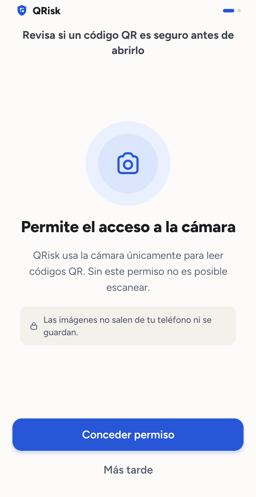 | 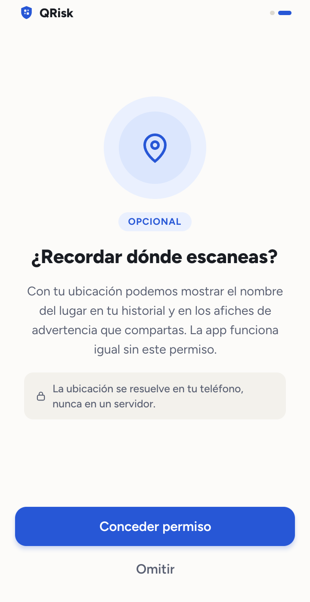 | 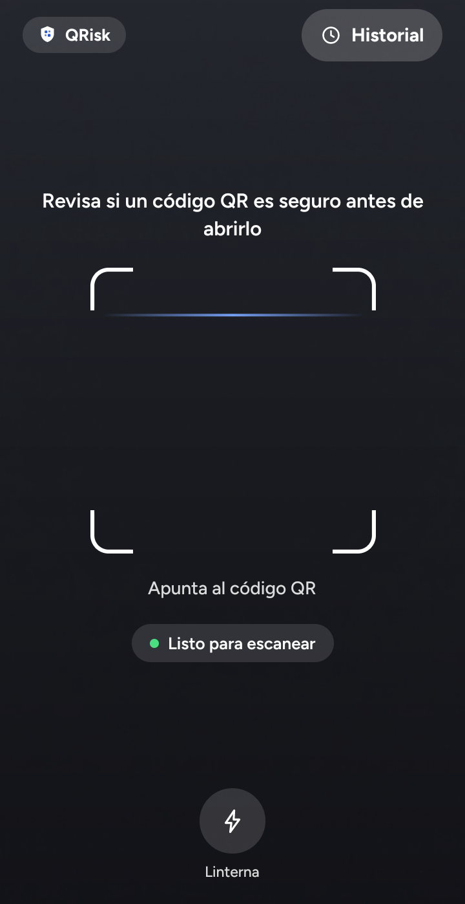 |
| **1.** Bienvenida: permiso de cámara | **2.** Bienvenida: permiso de ubicación, opcional | **3.** Escáner de códigos QR |
| 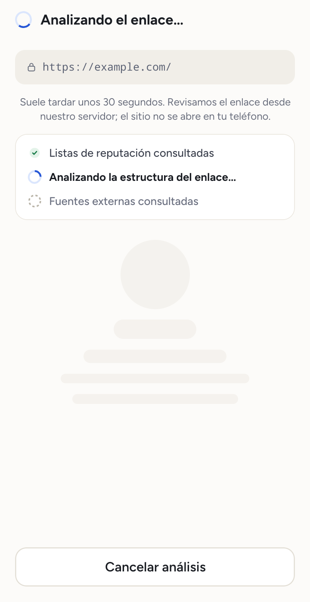 | 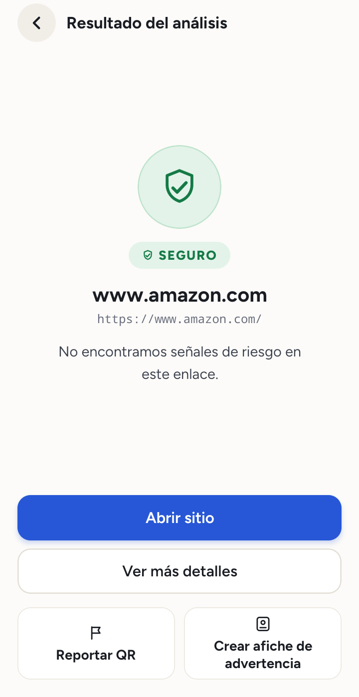 | 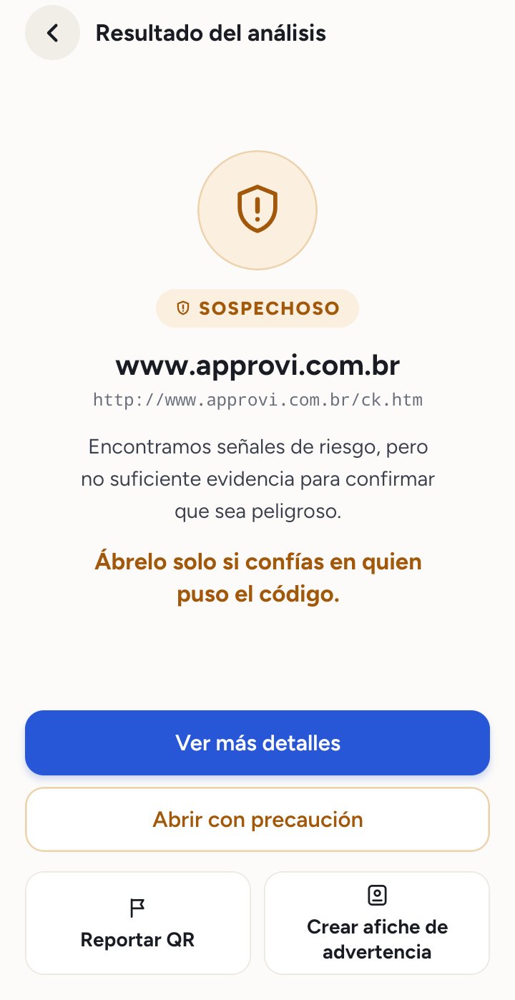 |
| **4.** Análisis en curso, por etapas | **5.** Resultado: seguro | **6.** Resultado: sospechoso |
| 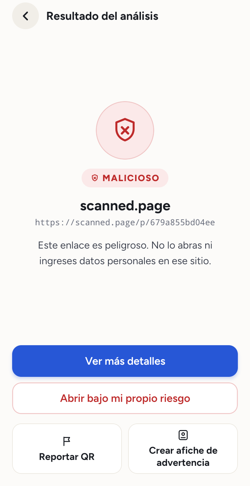 | 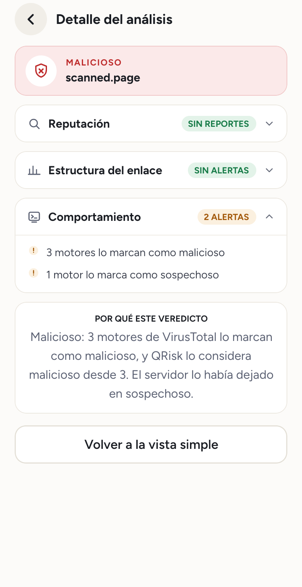 | 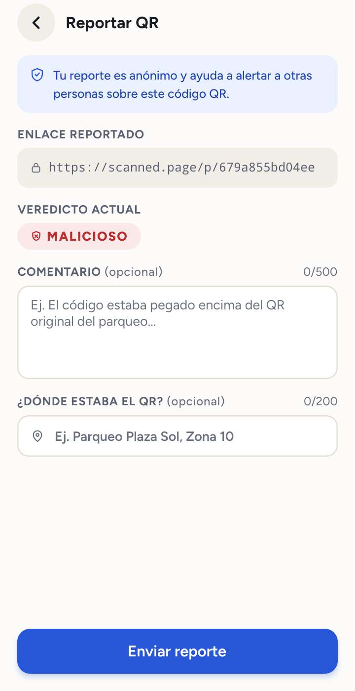 |
| **7.** Resultado: malicioso | **8.** Detalle del análisis y motivo del veredicto | **9.** Reporte anónimo de un código QR |
| 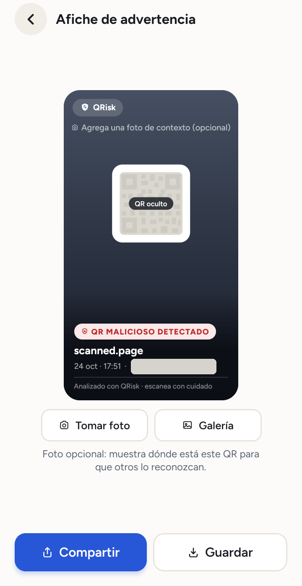 | 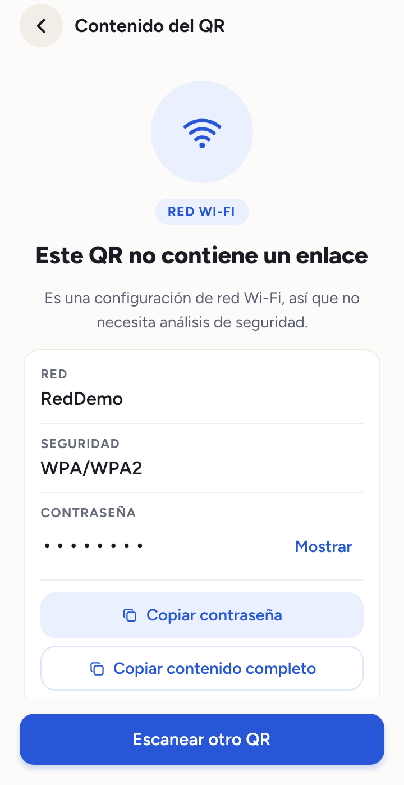 | 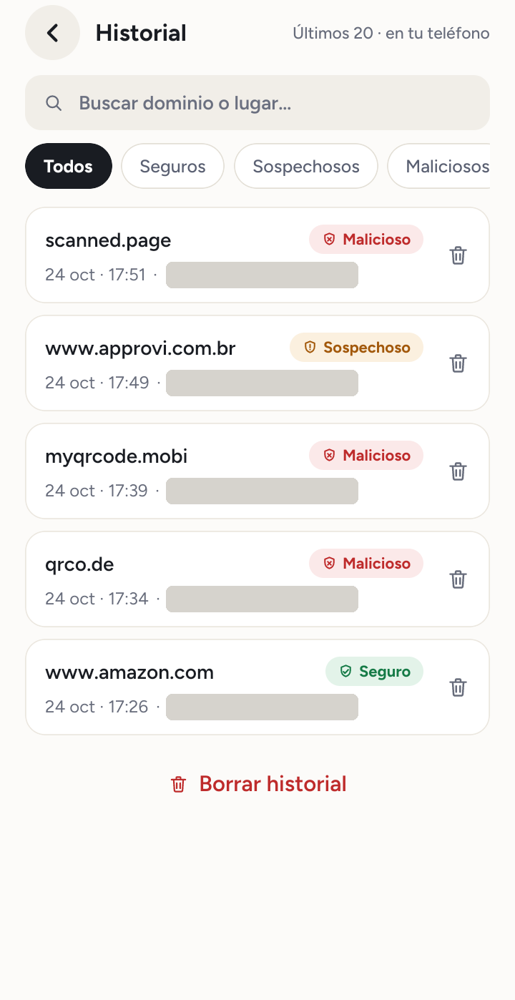 |
| **10.** Afiche de advertencia con el QR oculto | **11.** Código QR sin enlace: red Wi-Fi | **12.** Historial de escaneos con filtros |

## Demo

El video demostrativo está en [demo/demo.mp4](demo/demo.mp4). Dura unos 3 minutos y muestra la app en funcionamiento.

## Documentación

- [Informe final](docs/informe_final.pdf)
- [Consentimiento de uso de foto y video firmado](docs/consentimiento_firmado.pdf)
- [README técnico](src/README.md), con la arquitectura, el build, las pruebas y las limitaciones conocidas

## Autores

- María José Villafuerte Arredondo - 22129

Asesor: Ing. Mba. Juan Carlos Canteo

## Licencia

Este proyecto se distribuye bajo la licencia MIT. El texto completo está en [src/LICENSE](src/LICENSE).
